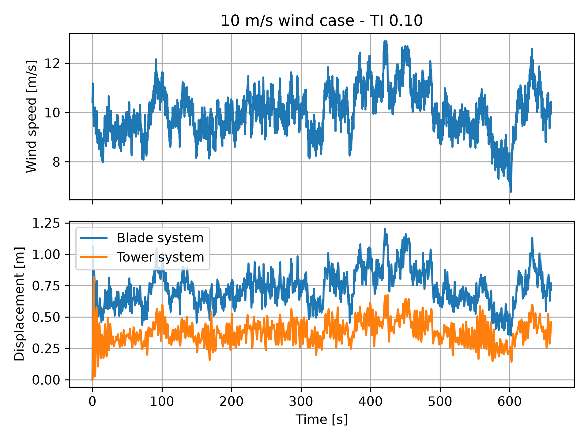
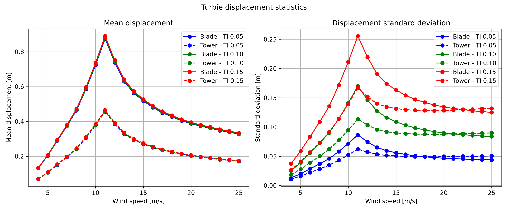

# Dynamic Response of a 2-DOF Wind Turbine Model to Turbulent Wind

Project 2 - 46W38 Practical Programming for Wind Energy

Student ID : s243524

Student Name : Sergio Correa

## Project description

In this project, a simplified wind turbine system consisting of two coupled masses is simulated: an equivalent 3-blade system and the turbine tower/nacelle system.

The horizontal dynamic response of both systems is investigated under high temporal resolution turbulent wind speed time series.

The simplified wind turbine model, called Turbie, has two degrees of freedom (2DOF): the fore-aft displacement of the equivalent blade system and the fore-aft displacement of the nacelle/tower system.

## Model

The dynamic system is represented by the equation of motion:

$$
M\ddot{x}(t) + C\dot{x}(t) + Kx(t) = F(t)
$$

where:

- $M$ is the mass matrix;
- $C$ is the damping matrix;
- $K$ is the stiffness matrix;
- $x$ contains the displacement coordinates of the blade and tower/nacelle systems;
- $\dot{x}$ contains their velocities;
- $\ddot{x}$ contains their accelerations;
- $F(t)$ is the external forcing vector.

The two displacement coordinates are:

$$
x(t) =
\begin{bmatrix}
x_1(t) \\
x_2(t)
\end{bmatrix}
$$

where $x_1$ corresponds to the equivalent 3-blade system and $x_2$ to the nacelle/tower system.

The aerodynamic force acts directly only on the blade system:

$$
F(t) =
\begin{bmatrix}
F_{aero}(t) \\
0
\end{bmatrix}
$$

The instantaneous aerodynamic force is calculated as:

$$
F_{aero}(t) =
\frac{1}{2}\rho C_T A
\left(u(t)-\dot{x}_1(t)\right)
\left|u(t)-\dot{x}_1(t)\right|
$$

where $\rho$ is air density, $A$ is rotor swept area, $u(t)$ is instantaneous wind speed, and $C_T$ is the thrust coefficient.

For each simulation, $C_T$ is kept constant and is obtained by linear interpolation of the provided $C_T$ lookup table using the mean wind speed of the complete wind time series.

The term $u(t)-\dot{x}_1(t)$ considers the difference between the instantaneous wind speed and the structural speed of the equivalent blade system in the wind direction.

To numerically solve the second-order differential equation, a state vector is introduced:

$$
y(t) =
\begin{bmatrix}
x_1(t) \\
x_2(t) \\
\dot{x}_1(t) \\
\dot{x}_2(t)
\end{bmatrix}
$$

The system is then expressed in first-order form:

$$
y'(t)=Ay(t)+B(t)
$$

where $A$ is the system matrix containing the mass, stiffness and damping contributions, while $B(t)$ contains the time-dependent aerodynamic forcing.

The resulting first-order dynamic system is integrated using `scipy.integrate.solve_ivp` with the RK45 method.

## Inputs

The model uses the input data provided by DTU.

The `inputs/turbie_inputs` folder contains:

- `turbie_parameters.txt`: masses, damping coefficients, stiffness coefficients, rotor diameter and air density;
- `CT.txt`: thrust coefficient lookup table as a function of wind speed.

The `inputs/wind_files` folder contains three turbulence intensity categories:

- TI = 0.05
- TI = 0.10
- TI = 0.15

Each category contains 22 high temporal resolution wind speed time series, with nominal mean wind speeds from 4 to 25 m/s.

Therefore, a total of 66 wind conditions are simulated.

## Methodology

The simulation workflow is:

1. Read the Turbie parameters from `turbie_parameters.txt`.
2. Build the mass, damping and stiffness matrices $M$, $C$ and $K$.
3. Build the first-order system matrix $A$.
4. Read the wind speed versus $C_T$ lookup table.
5. Automatically identify and sort the wind input files for each TI category.
6. For each wind time series:
   - read time and instantaneous wind speed;
   - calculate mean wind speed;
   - interpolate $C_T$ from the lookup table;
   - define the initial state with zero displacement and zero structural velocity;
   - solve the dynamic system using `solve_ivp`;
   - extract blade and tower/nacelle displacements and velocities;
   - calculate the relative blade and tower displacements;
   - save the complete time series results;
   - calculate mean and standard deviation of the displacements.
7. Save a statistics file for each TI category.
8. Generate figures describing the time response and the influence of wind speed and TI.

## Repository structure

```text
Project02_46W38/
├── README.md
├── LICENSE
├── main.py
├── turbie_mod.py
├── inputs/
│   ├── turbie_inputs/
│   └── wind_files/
└── outputs/
    ├── TI_0.05/
    ├── TI_0.1/
    ├── TI_0.15/
    └── figures/
```

`turbie_mod.py` contains the functions used to define and solve the Turbie dynamic model.

`main.py` controls the complete simulation workflow, iterates over all wind speed and TI cases, saves the results and generates the figures.

Each TI output folder contains one time-series result file for each of the 22 wind speed cases and one summary statistics file for that TI category.

## Running the project

External Python packages used by the project are:

- NumPy
- SciPy
- Matplotlib

The Python standard library `pathlib` module is also used for file and folder management.

From the repository root, run:

```bash
python main.py
```

The script processes all 66 wind cases and writes the simulation results, statistics and figures to the `outputs` folder.

## Outputs

Each wind speed simulation produces a text file containing:

- time;
- wind speed;
- $x_1$;
- $x_2$;
- $\dot{x}_1$;
- $\dot{x}_2$;
- relative blade-system displacement;
- relative tower-system displacement.

For each TI category, a separate statistics file contains:

- nominal wind speed;
- mean wind speed;
- blade displacement mean;
- blade displacement standard deviation;
- tower displacement mean;
- tower displacement standard deviation.

## Results

### Time-series response

The following figure shows the wind speed and structural response for the 10 m/s, TI = 0.10 case.



The blade-system displacement follows the larger wind speed variations relatively closely. The tower-system displacement shows a stronger oscillatory response.

A damped initial transient is also visible before the system response becomes dominated by the continuously varying turbulent wind forcing.

### Influence of wind speed and turbulence intensity

The mean and standard deviation of the blade and tower displacements for all wind speed and TI cases are shown below.

In the plots, the color represents turbulence intensity, while the line style distinguishes the blade and tower systems.



## Discussion

### Effect of wind speed

The mean displacements of both the blade and tower systems increase considerably from 4 m/s to approximately 11 m/s.

The maximum mean displacement occurs around 11 m/s. Between 11 and 12 m/s the mean displacement decreases significantly and then continues decreasing more gradually toward 25 m/s.

This behavior is related to the thrust coefficient used by the aerodynamic force model. The lookup table maintains a relatively high $C_T$ upssarily produce increasing displacement throughout the complete wind speed range because the aerodynamic force also depends on $C_T$.

### Effect of turbulence intensity

Turbulence intensity has relatively little influence on the mean displacement compared with its influence on displacement variability. The mean-displacement curves for TI = 0.05, 0.10 and 0.15 remain close to each other.

In contrast, the standard deviation increases strongly with TI for both structural systems. Higher turbulence intensity produces larger variations in the instantaneous wind forcing and consequently larger fluctuations in structural displacement.

For example, at approximately 10 m/s the blade displacement standard deviation increases from about:

- 0.072 m for TI = 0.05;
- 0.141 m for TI = 0.10;
- 0.211 m for TI = 0.15.

### Blade and tower response

The equivalent blade system presents larger mean displacement than the tower system over the complete wind speed range.

The blade system also generally presents larger displacement variability.

The time-series response shows that the blade-system displacement follows the larger variations in wind speed more directly, while the tower response contains a stronger oscillatory component caused by the coupled dynamic behavior of the two-degree-of-freedom system.

Both systems show an initial transient response because the simulations start with zero displacement and zero structural velocity while aerodynamic forcing is already acting on the turbine.

## Note on rotor diameter

The Project 2 instructions list a rotor diameter of 180 m, while the provided `turbie_parameters.txt` input file specifies `Dr = 178 m`.

The model implemented in this repository reads the turbine parameters directly from the provided input file instead of hardcoding them.

Therefore, the simulations presented here use a rotor diameter of 178 m.
